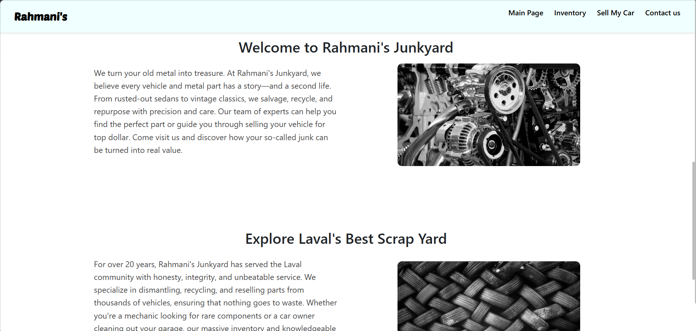
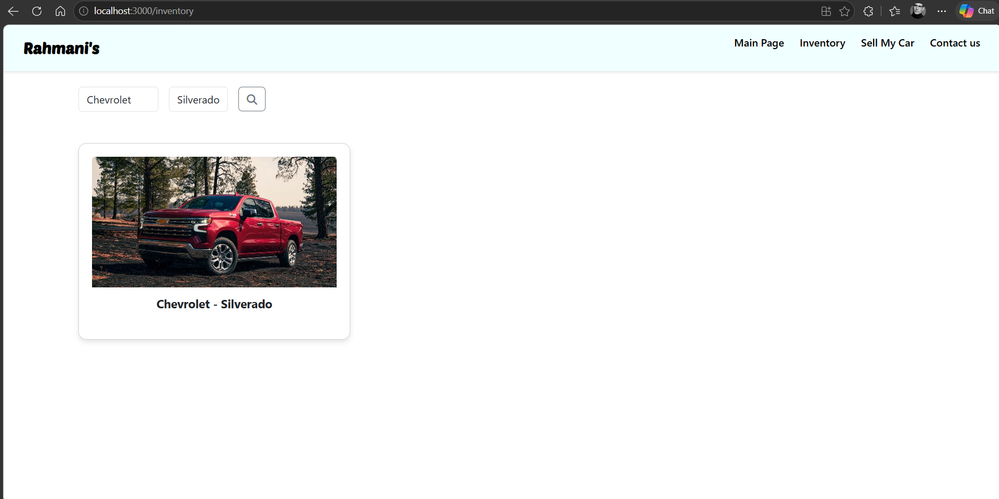
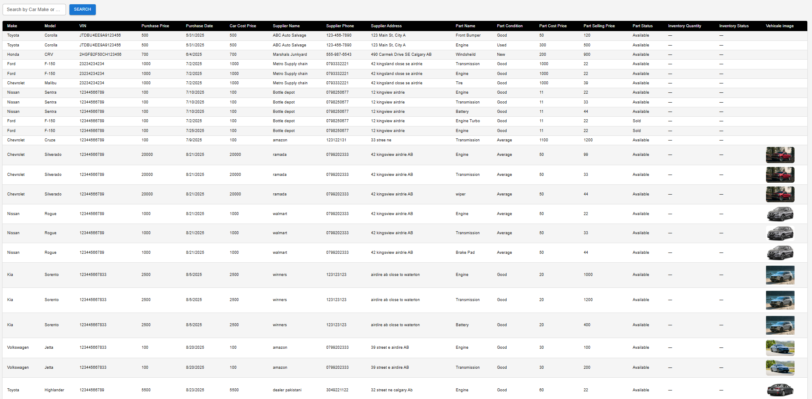
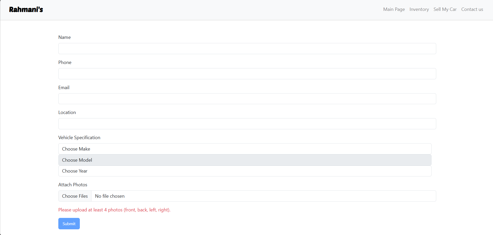
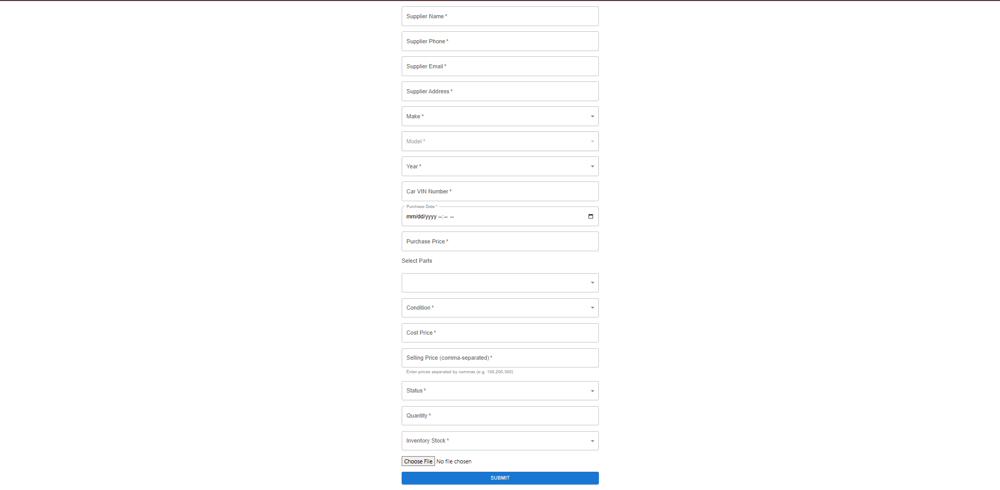
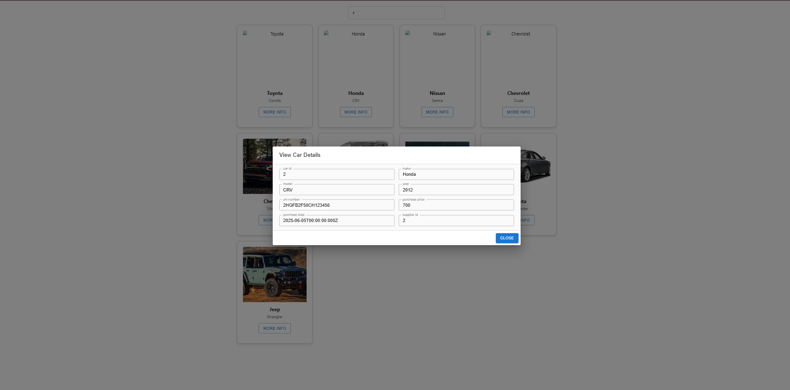
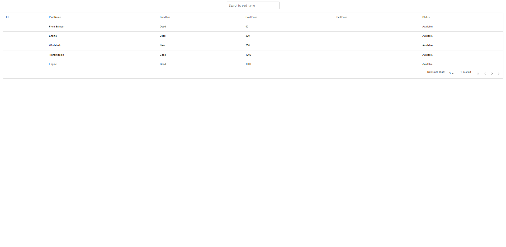
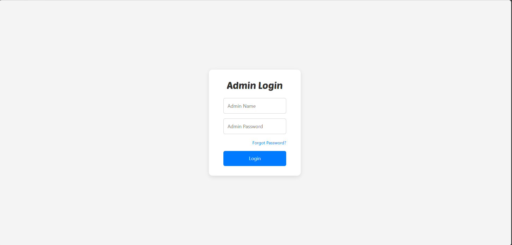
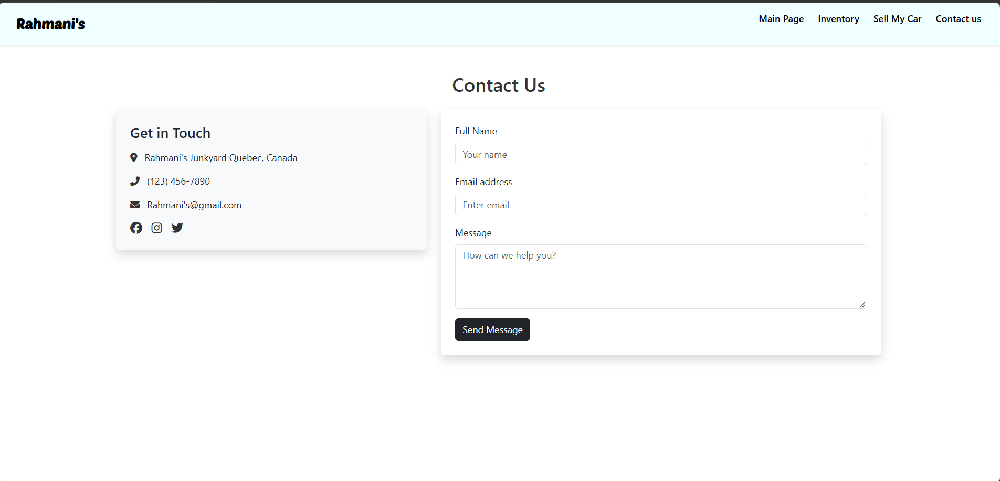
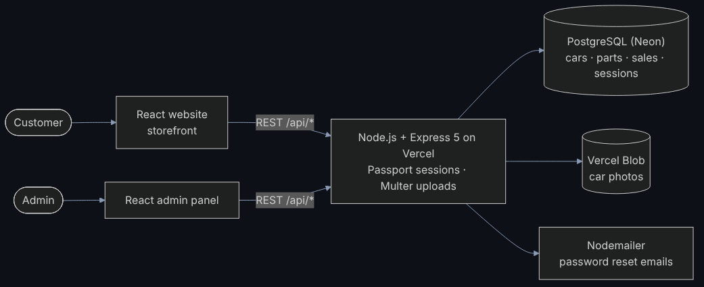

# 🚗 Rahmani's Junkyard

A full stack web app for a car salvage yard: a **storefront** where customers find cars and parts or sell their own car, and a **secure admin panel** where staff manage vehicles, parts, inventory, sales, customers and suppliers.



## Screenshots

| Inventory search | Car details | Sell My Car |
|---|---|---|
|  |  |  |

| Admin dashboard | Add vehicle | Vehicle inventory |
|---|---|---|
|  |  |  |

| Customers | Sales and payments | Parts |
|---|---|---|
|  |  |  |

| Admin login | Forgot password | Contact us |
|---|---|---|
|  |  |  |

## Features

**Customers**
- Search vehicles by make and model, with photos and details
- **Sell My Car:** send the car's details with 4 required photos (front, back, left, right)
- Contact form that lands in the admin's inbox

**Admin**
- Login with sessions, and password reset by email
- Dashboard with sales and purchase charts, total sales, paid and pending amounts
- Add a vehicle with its supplier, parts, prices and stock in one form
- Search, edit and delete vehicles and parts
- Manage customers and suppliers
- Record sales with paid and pending payments; every purchase and sale is also logged as a transaction
- Read, mark and delete customer messages; review cars customers want to sell

## Tech stack

| Part | Used |
|---|---|
| Frontend | React |
| Backend | Node.js, Express 5 |
| Database | Microsoft SQL Server (`mssql`) |
| Auth | Passport (local strategy), express-session, bcrypt |
| Files and email | Multer (photo uploads), Nodemailer (reset emails) |

## Design

### Use cases


### Architecture


### Database
One car is bought from a supplier, split into many parts, and each part is stocked in inventory and sold to customers.


### Buying a car and selling a part


## Run it locally

You need Node.js and a SQL Server database.

```bash
cd server
npm install
cp server.env.example server.env   # then fill in your own values
node server.js                      # API on http://localhost:5000
```

`server/server.env.example` lists every setting: database connection, the email account used for password resets, and the session secret. Never commit the real `server.env`.

## Project structure

```
Rahmani-s-Group/
├── rahmanis-website/   # React frontend
├── server/
│   ├── server.js       # Express API: auth, cars, parts, sales, customers, messages
│   ├── uploads/        # uploaded car photos
│   └── server.env.example
├── screenshots/        # screenshots used in this README
└── docs/               # diagrams (PNG + Mermaid source)
```

## Author

**Rohullah Hussaini** · [GitHub @Rohullah1122](https://github.com/Rohullah1122) · [Portfolio](https://rohullah-hussaini.vercel.app)
