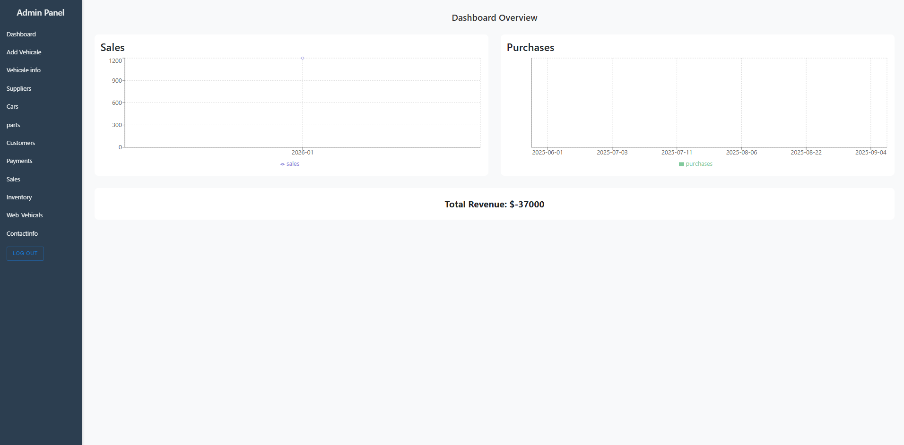
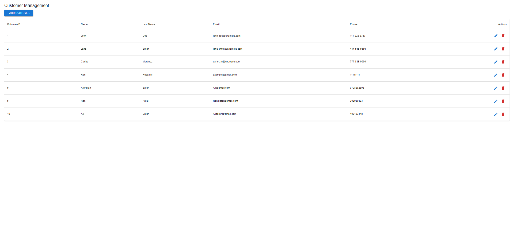
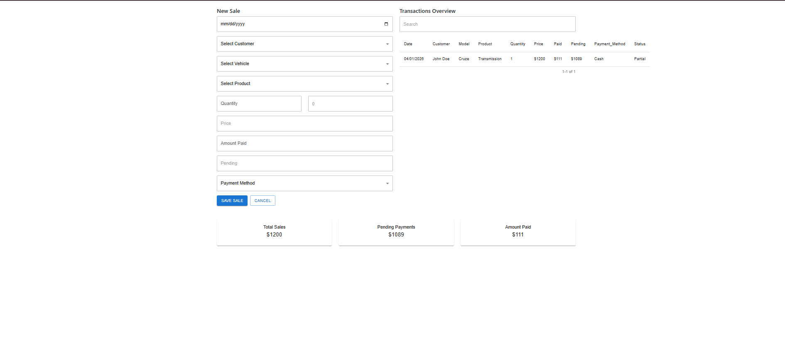
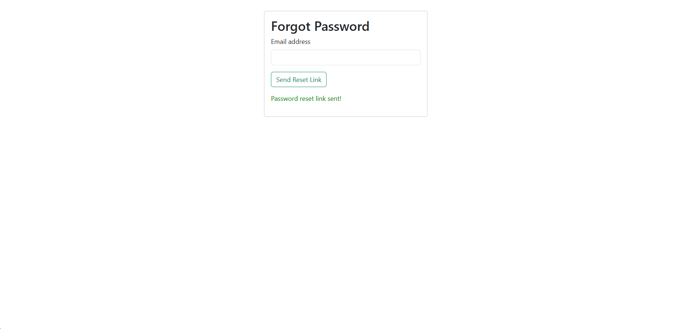
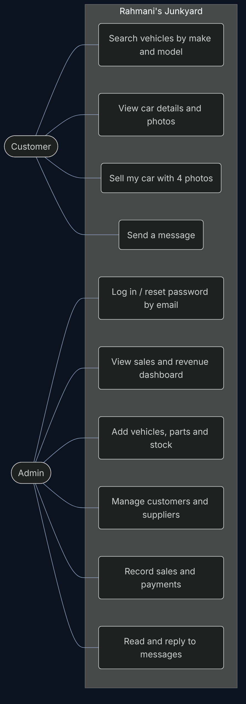
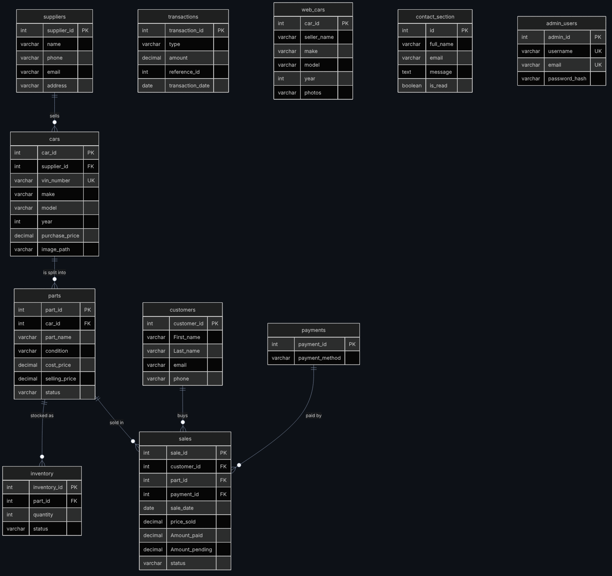
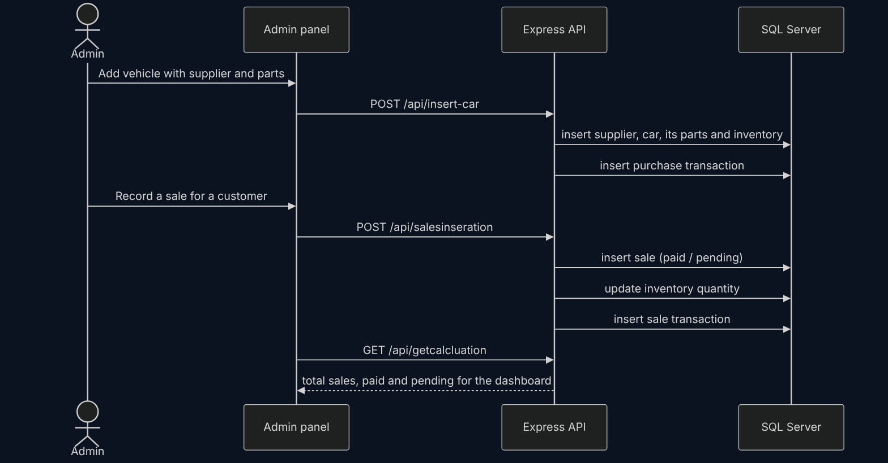

# 🚗 Rahmani's Junkyard

A full stack web app for a car salvage yard: a **storefront** where customers find cars and parts or sell their own car, and a **secure admin panel** where staff manage vehicles, parts, inventory, sales, customers and suppliers.


## Screenshots

| Inventory search | Car details | Sell My Car |
|---|---|---|
|  |  |  |

| Admin dashboard | Add vehicle | Vehicle inventory |
|---|---|---|
|  |  |  |

| Customers | Sales and payments | Parts |
|---|---|---|
|  |  |  |

| Admin login | Forgot password | Contact us |
|---|---|---|
|  |  |  |

## Features

**Customers**
- Search vehicles by make and model, with photos and details
- **Sell My Car:** send the car's details with 4 required photos (front, back, left, right)
- Contact form that lands in the admin's inbox

**Admin**
- Login with sessions (saved in the database), and password reset by email
- Every admin API route checks the login on the server, not only in React
- Dashboard with sales and purchase charts, total sales, paid and pending amounts
- Add a vehicle with its supplier, parts, prices and stock in one form
- Search, edit and delete vehicles and parts
- Manage customers and suppliers
- Record sales with paid and pending payments; every purchase and sale is also logged as a transaction
- Read, mark and delete customer messages; review cars customers want to sell

## Tech stack

| Part | Used |
|---|---|
| Frontend | React |
| Backend | Node.js, Express 5 |
| Database | PostgreSQL (`pg`), Neon on the live site |
| Auth | Passport (local strategy), express-session, bcrypt |
| Files and email | Multer + Vercel Blob (photo uploads), Nodemailer (reset emails) |
| Hosting | Vercel (React build + Express as a serverless function) |

## Design

### Use cases


### Architecture


### Database
One car is bought from a supplier, split into many parts, and each part is stocked in inventory and sold to customers.



### Buying a car and selling a part


## Run it locally

You need Node.js and PostgreSQL.

```bash
# 1. make an empty database
psql -U postgres -c "CREATE DATABASE rahmanis;"

# 2. API
cd server
npm install
cp server.env.example server.env   # then fill in DATABASE_URL, SECRET and the ADMIN_ values
npm run migrate                     # creates the tables, demo data and your first admin
npm start                           # API on http://localhost:5000

# 3. website (new terminal)
cd rahmanis-website
npm install
npm start                           # http://localhost:3000, /api calls go to port 5000
```

The admin panel is at `/admin`.

## Put it online (Vercel)

1. Import this repo on Vercel. Framework preset: **Other** (`vercel.json` has the settings).
2. **Storage** tab: add a **Neon** Postgres database (env prefix `DATABASE`, so you get `DATABASE_URL`) and a public **Blob** store (gives `BLOB_READ_WRITE_TOKEN`).
3. **Settings → Environment Variables**: add `SECRET` (long random text), `ADMIN_USERNAME`, `ADMIN_EMAIL`, `ADMIN_PASSWORD` (10+ characters), and `EMAIL_USER` / `EMAIL_PASS` for reset emails.
4. Redeploy. Each deploy runs `server/migrate.js`, which creates the tables and the first admin.

## Project structure

```
Rahmani-s-Group/
├── rahmanis-website/        # React frontend (storefront + admin panel)
│   └── src/
│       ├── client_side/     # Main page, Inventory, Sell My Car, Contact
│       ├── admin_side/      # Login, dashboard, vehicles, parts, sales, customers, messages
│       └── utils/           # car makes and models, photo helpers
├── server/
│   ├── server.js            # Express API: auth, cars, parts, sales, customers, messages
│   ├── migrate.js           # creates tables, demo data and the first admin
│   └── server.env.example
├── api/index.js             # runs the Express API on Vercel
├── database/migrations/     # SQL: schema and demo data
├── screenshots/             # screenshots used in this README
├── docs/                    # diagrams (PNG + Mermaid source)
└── vercel.json
```

## Author

**Rohullah Hussaini** · [GitHub @Rohullah1122](https://github.com/Rohullah1122) · [Portfolio](https://rohullah-hussaini.vercel.app)
